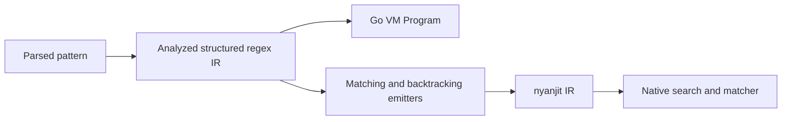

# PCRE2 performance baseline and nyanjit implementation plan

Measured on 2026-10-28. On the comparable portion of the upstream corpus,
gopcre2 is **165× slower than direct PCRE2 JIT at the median**. Reaching similar
speed requires changing allocation and search behavior as well as generating
native matching code. nyanjit's current pointer-call interface also needs work.
This baseline was recorded before the implementation. The current
[optional JIT](../../jit/README.md) and implementation results below follow it.

## 2026-10-29 handoff follow-up

The [php2go handoff report](../laravel/README.md) records seven fidelity fixes,
reusable child VMs and per-Regexp pools, FIRST-set/anchoring/alternative filters,
and the ranked Laravel JIT extensions. All 440 pre-handoff passing interpreter
cases remain correct; total matching capture vectors increase to **464/633**.
On that fixed 440-case cohort the interpreter is **5.96× faster geometrically**,
with median latency 1,014 ns to 203 ns and median allocations five to one.
[Before/after evidence](results/2026-10-29-handoff-core) preserves both worker
identities, full validation, all samples and the cohort.

The latest [177-case native comparison](results/2026-10-29-arm64-jit), measured
in isolated processes on CPU 6 with seven repetitions, gives **1.12×**
reusable/direct-JIT time geometrically and **1.72×** at p90. All reusable samples
are allocation free. Public allocating calls average **3.07×** direct JIT time.
There remain 360 declined patterns, 52 non-ASCII UTF subject fallbacks, and 44
parser rejections. The original 368-case passing baseline remains green.
The sections below preserve the earlier measurements and original plan.

## Implemented milestones (2026-10-28 checkpoint)

The optional compiler generates separate forward and reverse backtracking paths
from an immutable structured pattern. It supports byte literals/classes/types,
scoped options, specialized repeats, captures, alternation, atomic groups,
lookaround and numeric backreferences. Restoration paths follow the matching
path; there is no generated VM dispatch loop. Bounded repeats track the active
iteration without revisiting equivalent optional-skip combinations.

The interpreter reuses its outer VM across candidate starts, keeps resume state
private, retains captures declared in zero repeats, and exits empty iterations
with restorable progress guards. Byte mode now reads one code unit per byte;
UTF decoding requires `UTF`, independently of `UCP`. Prefixes, search advancement,
class predicates, boundaries and case folding use the selected mode. This fixes
an earlier implicit-UTF behavior; callers relying on it must enable `UTF`.

All 368 originally passing timing cases remain correct. On the same 633
eligible upstream cases, identical interpreter capture vectors rose from 368
to **440**. There are still 149 different results and 44 parser rejections,
with zero worker timeouts or panics. Native comparisons pass on **173** cases;
384 patterns fall back, 32 more have unsupported non-ASCII UTF subjects, and
44 are rejected by the parser. Native byte subjects can contain any byte.

The independent [encoding fixture suite](../../testdata/README.md) adds 12,375
binary-safe cases generated with PCRE2 10.49. The native PCRE2 interpreter and
JIT agree on these fixtures. The optional compiler checks 12,327 of them
natively, with 23 subject fallbacks and seven pattern fallbacks; 18 fixtures
are compile errors checked by the base compiler. Fixtures include every byte
under plain/UCP/caseless/UCP+caseless options, embedded NULs, invalid UTF,
class negation, range escapes, word boundaries and backreferences.

Seven-repetition arm64 measurements of the expanded 173-case subset give:

| Measurement | One process per case | All JIT cases in one process |
| --- | ---: | ---: |
| Reusable / direct PCRE2 JIT, geometric mean | 1.06× | 1.34× |
| Reusable / direct PCRE2 JIT, median paired ratio | 0.98× | 1.10× |
| Reusable / direct PCRE2 JIT, p90 paired ratio | 1.68× | 4.59× |
| Median reusable latency; allocations | 13.58 ns; zero | 18.72 ns; zero |
| Median allocating public API latency | 45.19 ns | 48.50 ns |
| Public API / direct PCRE2 JIT, geometric mean | 3.00× | 3.32× |
| Public API / general PCRE2 API with JIT, geometric mean | 2.13× | 2.37× |
| Original Go / new public API, same 142-case intersection | 55.14× | 51.08× |
| Prepared Code.Call control / leased matcher, geometric mean | 2.93× | 2.59× |

The per-case process setup matches the original Go/native baseline and is the
runner's default. On that fixed 142-case intersection, the original
Go/direct-JIT gap is 161.50×, and the new public API/direct-JIT gap is 2.93×.
The two runs have identical production Go sources and nyanjit source hashes;
only the benchmark selection harness changed. No faster focused samples are
substituted into either aggregate.

The isolated run meets the proposed geometric-mean and p90 targets on this
subset; **the combined run misses the p90 target**. Absolute overhead is at
most 50 ns on 161/173 isolated cases and 151/173 combined cases. Case 596's
sequence of lazy class repeats is 6,736 ns versus 543 ns native even in
isolation; case 175, `\d+123`, is 120 ns versus 15 ns native. Required-character
scans and specialized repeat continuations remain useful next optimizations.

Some tiny cases are sensitive to the benchmark context: case 6 is 65 ns in the
combined run and 9.4 ns in a focused run of the same binary; case 63 is 170 ns
versus 18 ns. All repeated capture checks pass. A layout/runtime explanation
has not been established. The harness now supports one process per case, as
used by the original Go/native baseline, and preserves the combined results
separately; focused faster reruns are not substituted into the combined table.

The earlier 146-case ASCII milestone measured 1.15× reusable/direct-JIT and
3.01× public/direct-JIT geometrically, with 13.83 ns median reusable latency.
It is historical evidence for a narrower cohort, rather than the current full
coverage claim. Full UTF execution, general repeated groups, recursion and the
remaining PCRE2 features still lie outside the native subset.

The fast entry requires two new sibling nyanjit files:
[`leaf_func.go`](../../../nyanjit/backend/execution/leaf_func.go) and its tests.
`LeafFunc` returns a retained mapping lease and a typed leaf entry, avoiding
per-call reflection and permanent mapping quarantine. The matcher keeps the
lease and typed argument roots alive explicitly. Existing source changes in
nyanjit were not overwritten.

Saved evidence includes the [ASCII milestone](results/2026-10-28-arm64-jit),
[expanded isolated run](results/2026-10-28-arm64-byte-jit), and
[expanded combined run](results/2026-10-28-arm64-byte-shared): per-case medians,
all raw repetitions, full interpreter validation, source identities, and an
`implementation.tar.gz` containing the exact core/JIT sources, fixtures and
nyanjit additions for that worker. The
nyanjit revision is `29aa5790dc7ccd5510dea0d79fafe8ccdb5347db` plus the two named
leaf-entry files. The harness snapshots gopcre2 and archives that revision, so
concurrent checkout edits cannot change a measured worker. JIT samples target
20 ms; native PCRE2 and updated-interpreter samples target 3 ms. Compilation
and validation run outside timing. Benchmark workers run sequentially on CPU 7
with one Go P and GC enabled; original Go values come from the saved baseline.

Base and companion race tests pass. The companion also passes with cgo disabled;
amd64 is compile-checked, while execution and measurements remain arm64 only.
The next coverage work is a validated UTF-8 decoder and character-width-aware
iterators/capture rollback, then Unicode tables and general repeated groups.
The upstream `testinput*` parser and the remaining interpreter differences
remain separate conformance work before any whole-library parity claim.

## Baseline

Reference: [PCRE2 10.49](https://github.com/PCRE2Project/pcre2/releases/tag/pcre2-10.49),
commit `6f9d7c1373262c541324a16a358785b33ef116cf`, and its original
[`src/pcre2_jit_test.c` regression table](https://github.com/PCRE2Project/pcre2/blob/6f9d7c1373262c541324a16a358785b33ef116cf/src/pcre2_jit_test.c).
gopcre2 revision: `8830ee9776e3053f767192b2680fb79be28c7798`.

Host: Linux/arm64, Cortex-X925, CPU 7, performance governor, 3.9 GHz maximum;
Go 1.27.2; GCC 13.3.0, `-O3 -DNDEBUG`. The workers run sequentially on the
same pinned core. Go uses one P and leaves garbage collection enabled.

There are 706 cases in this table with Unicode enabled. The harness lets the C
compiler interpret the original table, preserving escapes, option bits, newline
settings, subjects, and test order. It does not translate patterns or replace
subjects with convenient examples.

For each eligible case, it first compares the full returned capture-offset
vector, including unset trailing groups. Only matching results enter the timing
comparison. Three native modes are measured: interpreter (`PCRE2_NO_JIT`),
`pcre2_jit_match`, and the general `pcre2_match` API using compiled JIT code.
The Go operation is the public `FindStringSubmatchIndex` API.

Patterns are compiled once per worker, outside the match timing. Native match
data, match context, and JIT stack are reused, as they normally would be by a
native caller. Go allocates whatever its existing API requires. Thus this is an
**API-level gap**, including scratch allocation and result allocation, rather
than an isolated comparison of VM dispatch with machine instructions. Direct
JIT skips some checks made by the general native API; both numbers are given.
Callout callbacks are unset in both engines.

Each measured case has seven samples per mode. Each sample doubles its iteration
count until at least 3 ms elapses; calibration batches are discarded. Native
mode order rotates between samples. Reported case timings are sample medians.

| Comparison across 368 measured cases | Result |
| --- | ---: |
| Median of Go / direct-JIT case ratios | 165.00× |
| Geometric mean of Go / direct-JIT case ratios | 165.00× |
| 90th percentile of Go / direct-JIT case ratios | 469.55× |
| Ratio of sums of median Go and direct-JIT times | 142.74× |
| Median Go / general native API with JIT | 116.06× |
| Median Go / native interpreter | 28.48× |
| Median Go time across cases | 2,806 ns |
| Median direct-JIT time across cases | 13.43 ns |
| Median Go allocation across cases | 25,328 B; 13 allocations |

The ratio of the two independently calculated median times is not the median
of paired ratios. Each case receives equal weight; the corpus does not define
a production workload distribution. Among measured successful matches (312),
the median paired slowdown is 142×; among measured no-matches (56), it is 446×.
Median within-case relative median absolute deviation is 0.78% for Go and
0.079% for direct JIT. These are timing-variation descriptions, not confidence
intervals across machines.

Representative unchanged corpus cases:

| Case | Pattern | Go ns | Direct JIT ns | Go B/op | Go allocs/op |
| --- | --- | ---: | ---: | ---: | ---: |
| 1 | `AbC` | 739 | 14.51 | 8,432 | 5 |
| 39 | `..a.....b` | 14,377 | 11.58 | 168,336 | 81 |
| 130 | `(?:AA)*AB` with external caseless flag | 7,431 | 61.98 | 75,760 | 37 |
| 175 | `\d+123` | 9,220 | 14.71 | 92,592 | 45 |
| 196 | `(?:(ab){1,4}){1,3}abababababababababababM` | 40,815 | 6.71 | 92,752 | 44 |
| 325 | `(?>a)*?(?>a)+?(?>a)??x` | 199,394 | 333.15 | 2,469,392 | 350 |

Case 196's subject is too short for a match. Its gap illustrates the value of
minimum-length rejection before starting the VM. Case 39 illustrates repeated
allocation while searching candidate starts. Corpus options are essential to
interpreting these examples; the raw export retains all of them.

## Coverage and correctness limits

| Outcome | Cases |
| --- | ---: |
| Identical returned captures; measured | 368 |
| Different match or capture offsets | 195 |
| Go compile error | 44 |
| Worker timeout | 26 |
| Match-time options absent from the public Go API | 34 |
| Nonzero start offset absent from that API | 16 |
| Upstream excludes 8-bit execution | 13 |
| Native match-limit errors | 6 |
| Upstream explicitly disables result comparison | 3 |
| Unsupported external compile options | 1 |
| Total | 706 |

There were 633 cases eligible for comparison against a successful native
execution or ordinary native no-match. Only 368 returned identical captures.
Timing the 195 different results would reward incorrect or incomplete work.
Examples include newline/CRLF search behavior (case 11), non-UTF byte semantics
(case 26), and lost capture declarations in a zero-repeat group (case 136).
Many timeouts involve repeated groups that can match an empty string. The
original runner used 3 s validation and 10 s timing-worker deadlines; its
26 timeout records do not identify which phase expired, so they are not
claimed as a precise single-match latency lower bound. New runs record the phase.

This is the main JIT regression table, **not every PCRE2 test**. The separate
invalid-UTF and 16/32-bit suites, the `testdata/testinput*` files, callback
behavior, MARK values, partial matches, and multi-match iteration have not been
differentially covered here. Equality on these specific inputs does not prove
general semantic equivalence. Go's public API also conflates limit failures
with no-match. These limitations belong in the next conformance milestone.

## What accounts for the gap

At baseline, `findMatch` created a fresh VM at every candidate position unless
its literal-prefix scan can skip candidates. Each VM allocates captures and a
backtracking stack with capacity for 64 large frames. The frames contain Go
pointers, so unused frame capacity also increases garbage-collector work.
Lookbehind additionally creates sub-VMs and capture buffers.

A separate 3.6-second CPU profile of case 39 attributes **96.7% cumulative CPU
time to `newVM`**, including **88.3% to `newBTStack`** and **85.3% to
`runtime.mallocgc`**. These percentages overlap and must not be added. Its
longer, profiled samples were 18.3–18.4 microseconds per call, versus 14.4
microseconds in the short unprofiled baseline. The profile identifies the
bottleneck; it is not substituted into the baseline timings.

`Program.MinLen` is calculated but not consulted by the search loop. Start
optimization is largely a multi-character literal prefix, with no general
first-character set, required-character search, or specialized repeat scanning.
Removing dispatch alone would leave these costs in place.

There is also a package-global `btPC` used to resume backtracking. Before
reusing execution state or adding JIT concurrency, make that state private to
the match invocation.

## nyanjit feasibility and the call-interface constraint

The sibling project already supplies Builder labels/Vars, integer and memory
operations, SIMD, `compile.NewTarget`/`Lower`, executable templates, Go ABI
entries, and managed Go callbacks. There is no need to build another assembler
or register allocator.

The probe measures the existing nyanjit working tree at HEAD
`08a7c239701ea4f748906f4f4daa27c568a00463`, including its pre-existing uncommitted
changes. Its status and a working-tree fingerprint are recorded with the
results. No nyanjit source was modified. Seven Go benchmark repetitions used
200 ms per sample, on the same core after the corpus workers finished.

| Tiny add-one entry | Median ns/op | B/op | allocs/op |
| --- | ---: | ---: | ---: |
| Ordinary Go function reference | 1.79 | 0 | 0 |
| Scalar `Code.Func` | 1.79 | 0 | 0 |
| Scalar `Code.Call` | 44.12 | 8 | 1 |
| Pointer-typed `Code.Func` | 179.1 | 56 | 3 |
| Pointer `Code.Call(execution.Words(...))` | 87.59 | 128 | 1 |

These are call probes, not generated-regex performance measurements. In the
current implementation, pointer-typed `Func` goes through `reflect.MakeFunc`
and `reflect.Call`. `Code.Call` tracks active calls and prepares arguments;
`Words` adds preparation of its own. The fast scalar `Func` path permanently
quarantines its executable mapping, even after `Close`, so it is not a complete
solution for arbitrarily many user-supplied patterns. Managed callback entries
also retain runtime metadata/mappings.

Since many native cases take 6–20 ns, these interface choices can determine
whether parity is possible. Obtain a fast, owner-bound entry interface with
proven heap-root lifetimes and a bounded executable-memory policy before
committing to a general JIT architecture. Simply casting pointers to integers
to bypass wrappers is not an adequate lifetime contract.

The implementation first used prepared `Words` arguments with `Code.Call`,
then added a leased leaf entry to address the remaining fixed gateway cost.
The measurements in the implementation section supersede this one-shot probe
as the execution-interface feasibility result.

## Implementation sequence and acceptance gates

The architecture below follows the user's suggestion to mimic PCRE2's JIT.
It refines the code-generation part of this sequence.

### Use PCRE2's JIT strategy with nyanjit as the backend

PCRE2's JIT is a compiler for its compiled regex representation. It emits
forward matching paths and separate backtracking paths, and performs the
unanchored search inside generated code. Its source explains the layout using
`A(B|C)D`: matching proceeds forward; failures unwind the corresponding
backtracking paths in reverse order. See the
[design explanation](https://github.com/PCRE2Project/pcre2/blob/pcre2-10.49/src/pcre2_jit_compile.c#L109),
[main compilation routine](https://github.com/PCRE2Project/pcre2/blob/pcre2-10.49/src/pcre2_jit_compile.c#L13528),
and [iterator backtracking emitter](https://github.com/PCRE2Project/pcre2/blob/pcre2-10.49/src/pcre2_jit_compile.c#L12056).

| PCRE2 mechanism | Proposed gopcre2 / nyanjit counterpart |
| --- | --- |
| Bytecode analysis and private-data layout | Analyze structured regex nodes; assign capture, repeat, and assertion state slots before emission |
| Matching-path and backtracking-path emitters | Two cooperating emitters using nyanjit labels, branches and Vars; put successful straight-line matching first |
| Compile-time backtracking descriptors and pending jumps | Compiler-owned descriptors with success/resume/failure labels; resolve through Builder labels |
| Specialized character iterators | Dedicated greedy, lazy, possessive, and bounded-repeat loops with only their required saved state |
| Generated start scans and minimum-length checks | A native search prologue and retry loop using shared analyzed metadata |
| Separate JIT stack and argument block | Per-invocation host-owned numeric scratch and captures, rooted through the entry interface |
| SLJIT machine-code emission | nyanjit IR, lowering, register allocation, executable binding, and target-specific SIMD |

The important adaptation is to retain regex structure. `Node` already records
`NdRepeat`, bounds and greediness; `compiler.compileRepeat` expands these into
the VM's primitive control flow. Introduce an analyzed, immutable regex IR at
that boundary, preserving repeats, groups, scoped options and resolved capture
IDs. Both VM compilation and JIT compilation consume that representation.
Reconstructing every quantifier from arbitrary `Split`/`Jump` graphs should
not be the foundation of the production JIT.



For a first implementation, use a compiler descriptor such as
`{kind, next, fail, resume, stateSlots, children}`. This is compilation metadata,
not an object allocated during matching. Literal/class checks branch directly
to their failure continuation. A greedy single-character repeat scans forward,
saves its bounds, then exposes a backtracking path that retreats and retries
the continuation. A lazy repeat initially tries the continuation and extends
on backtracking. A proven possessive repeat needs no retry path. UTF retreat
and empty-repeat guards must follow the selected character/newline semantics.

Captures, alternatives and nested assertions add only the restoration data
needed by their specific failure paths. Prefer direct branches to known
backtracking blocks; introduce a runtime continuation dispatcher only where
dynamic nesting or recursion actually requires one. Keep native register
choices in nyanjit's allocator rather than copying SLJIT's fixed register
assignments. Allocate excess per-pattern private data in host-owned scratch;
PCRE2's local-frame limits cannot be copied into nyanjit's much smaller
goroutine-frame budget.

This strategy makes native allocation/search behavior part of the first JIT
milestone. Shared interpreter improvements remain useful, but completing an
extensive optimization of the interpreter is not a prerequisite for that
prototype. Start with literal/class checks, one greedy/lazy iterator, and an
alternative with captures; prove direct and backtracking paths against the
same corpus before adding the remaining constructs.

### Delivery order

1. **Make the corpus a conformance gate.** Preserve these case IDs and explicit
   exclusions, then add the upstream `testinput*` corpus with a proper
   pcre2test-format adapter. Correct byte versus UTF behavior, newline/BSR
   handling, flags, capture numbering, and empty-repeat progress. Move `btPC`
   into invocation state. Add internal error-aware comparison for match,
   depth, and heap limits, plus parallel matching checks. A case enters JIT timings
   only after its complete capture vector matches native PCRE2; report
   interpreter conformance separately so fallback cannot hide a discrepancy.

2. **Remove allocation and search bottlenecks in the shared executor.** Allocate
   scratch once per search, reset it between candidate positions, and reuse it
   across calls through a bounded pool or explicit reusable Matcher. Keep the
   Regexp immutable and scratch private to each invocation, including reentry.
   Replace pointer-bearing frames with compact tagged numeric records and a
   capture undo log; represent MARK/verb names by immutable program indices.
   Derive conservative minimum lengths and start/required-character metadata
   from the control-flow graph. Respect scoped flags, UTF byte widths,
   lookarounds, recursion, and backreferences when proving those facts.
   Gate: no allocation per candidate; warm reusable matching allocates zero
   scratch, with only the existing public API's returned result allocation.

3. **Resolve the nyanjit entry and lifetime interface.** Prototype a small
   callback-free Go-ABI matcher taking host-owned subject/capture/stack state.
   Measure a safe pointer-bearing entry, not just an integer add function.
   Use a no-reflection owner-bound bridge or add that capability to nyanjit;
   establish rooting, bounded frames, concurrent code use, and reclamation.
   Keep the full search loop inside one native entry. Gate: zero per-call
   interface allocations and roughly 5 ns entry overhead on this host; if
   that cannot be reached, document the absolute latency floor and revise the
   tiny-pattern target before proceeding. Existing scalar `Func` is useful
   for a bounded prototype, with its lifetime cost explicitly accounted for.

4. **Generate a scalar matcher for a verified subset.** Implement the PCRE2-style
   matching/backtracking emitters described above over the analyzed structured
   regex IR. Keep subject position, bounds, and stack cursor in
   Vars/registers. Generate literals, byte classes, anchors, alternation,
   greedy/lazy repeats, captures and backtracking first. Emit bounded memory
   accesses, empty-repeat progress guards, and match-work/stack-capacity checks.
   Use a caller-owned backtracking buffer; return to the host for growth or
   an unsupported condition with an explicit status. Initially fall back for
   an entire pattern, rather than making a Go call for every opcode. Gate:
   full capture equality on every case advertised as JIT-supported; separate
   coverage and fallback counts; no regressions to limit enforcement.

5. **Close algorithmic gaps and extend feature coverage.** Add literal runs,
   specialized single-character repeats, proven auto-possessification,
   required-byte rejection and start scans. Add NEON on arm64 and SSE2 on
   amd64 for searches once the scalar versions pass. Vector loads must stay
   within subject bounds. Precompute character-class/Unicode property tables;
   avoid runtime property-name parsing. Then add atomic groups, lookarounds,
   backreferences, and recursion/control verbs in corpus-driven batches.
   Use managed Go callbacks only where semantically necessary, such as
   user callouts, and validate their root/frame contract separately. Inspect
   nyanjit's code-size, stack and spill reports before using its lower-level
   backend to solve a demonstrated lowering problem.

6. **Package and roll out with measured targets.** Prototype behind an opt-in
   `jit` build tag and a local workspace. nyanjit currently requires Go 1.26
   whereas this module declares 1.25.3; account for that version increase and
   publish/pin its currently unpublished backend module before distribution.
   Preserve the interpreter on unsupported platforms and codegen limits.
   Bound compile work and executable memory; expose whether JIT was used.
   Measure compilation separately and use observed savings to choose a hotness
   threshold: `extra compile time / match time saved`. Do not infer it from
   the single cold compile observations saved by this harness.

   Proposed performance gate: on the supported subset, a reusable-output
   matcher within **2× native JIT by geometric mean**, with p90 within 3×;
   for native operations below 50 ns, also report an absolute overhead target
   of **50 ns or less**. Report the existing allocating public API separately.
   Keep both the original 368-case baseline cohort and newly passing cases
   visible so changing coverage cannot manufacture a speedup. Repeat on arm64
   and amd64, plus long inputs, failures, cold patterns, and concurrency, before
   claiming PCRE2+JIT-class performance. These are engineering targets, not
   results demonstrated by the current probe.

## Reproduction and saved evidence

From the repository root, with Go, GCC, CMake, Python 3 and Git installed:

```sh
git clone --depth 1 --branch pcre2-10.49 --recurse-submodules --shallow-submodules \
  https://github.com/PCRE2Project/pcre2.git /tmp/gopcre2-pcre2-10.49
cmake -S /tmp/gopcre2-pcre2-10.49 -B /tmp/gopcre2-pcre2-10.49/build \
  -DCMAKE_BUILD_TYPE=Release -DPCRE2_SUPPORT_JIT=ON \
  -DPCRE2_BUILD_PCRE2GREP=OFF -DPCRE2_BUILD_TESTS=ON \
  -DPCRE2_BUILD_PCRE2_16=OFF -DPCRE2_BUILD_PCRE2_32=OFF -DBUILD_SHARED_LIBS=OFF
cmake --build /tmp/gopcre2-pcre2-10.49/build -j 6
ctest --test-dir /tmp/gopcre2-pcre2-10.49/build --output-on-failure
python3 benchmarks/pcre2/run.py --source /tmp/gopcre2-pcre2-10.49 \
  --build /tmp/gopcre2-pcre2-10.49/build --output /tmp/gopcre2-baseline \
  --cpu 7 --samples 7 --duration-ms 3
python3 benchmarks/pcre2/analyze.py /tmp/gopcre2-baseline /tmp/gopcre2-evidence
```

Choose a suitable allowed core for `--cpu`; it refers to this host in the
recorded run. The runner is Linux-specific. The nested probe module uses local
replacements for the sibling `../nyanjit`, without modifying the root module:

```sh
cd benchmarks/pcre2/nyanjit
GOWORK=off go test -c -o /tmp/gopcre2-boundary
GOMAXPROCS=1 taskset -c 7 /tmp/gopcre2-boundary -test.run '^$' \
  -test.bench . -test.benchmem -test.benchtime=200ms -test.count=7
```

Saved evidence in [results/2026-10-28-arm64](results/2026-10-28-arm64):

- `cases.csv`: every case, status, timing medians, allocations, and captures.
- `groups.csv`: upstream feature groups with measured coverage and slowdowns.
- `metadata.json`, `summary.json`: baseline identity and aggregate results.
- `corpus.json.gz`, `results.jsonl.gz`: complete raw inputs and timing samples;
  inspect with `gzip -dc`. Corpus licensing is retained in
  [PCRE2-CORPUS-LICENSE](PCRE2-CORPUS-LICENSE).
- `nyanjit-boundary.txt`, `nyanjit-metadata.json`: probe results and working-tree identity.
- `case39-profile*`: flat/cumulative CPU profile text and longer sample timings.

Validation: existing `go test ./...` and `go test -race ./...` passed; the C
adapter compiled with `-Wall -Wextra -Werror`; the native CTest suite passed all
three tests, including the full upstream JIT test executable. This does not
change the compatibility failures listed above.
